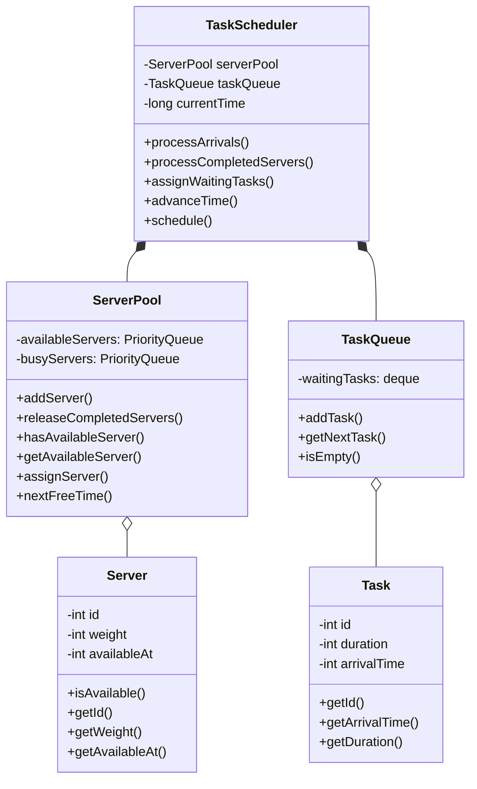

# Task Scheduler — LLD

A small system that assigns arriving tasks to a fixed set of servers over
time — the server with the lowest weight gets the next waiting task, ties
broken by index, and a server is busy until its task's duration elapses.

## Classes

| Class | Responsibility |
|---|---|
| `Server` | Immutable-ish entity: id, weight, `available_at`. No assignment logic. |
| `Task` | Task id, duration, arrival time (arrival defaults to the task's id). |
| `ServerPool` | Owns the available/busy priority queues; knows who's free and when. |
| `TaskQueue` | FIFO of arrived-but-unassigned tasks (`deque`). |
| `TaskScheduler` | Coordinates: arrivals → releases → assignments → clock. |

## Class diagram

## Notes

- `available_servers` ordered by `(weight, id)`; `busy_servers` ordered by
  `(availableAt, weight, id)`.
- `ServerPool` is built on `queue.PriorityQueue` (no peek; `nextFreeTime()`
  exists so the scheduler can jump the clock without reaching inside).
- `Server` carries no heap ordering and no `assignTask` — the pool owns all
  timing decisions; `assignServer` sets `available_at` at assignment time.
- Composition: `TaskScheduler` owns `ServerPool` and `TaskQueue`; the pool and
  queue aggregate `Server` / `Task` values.
